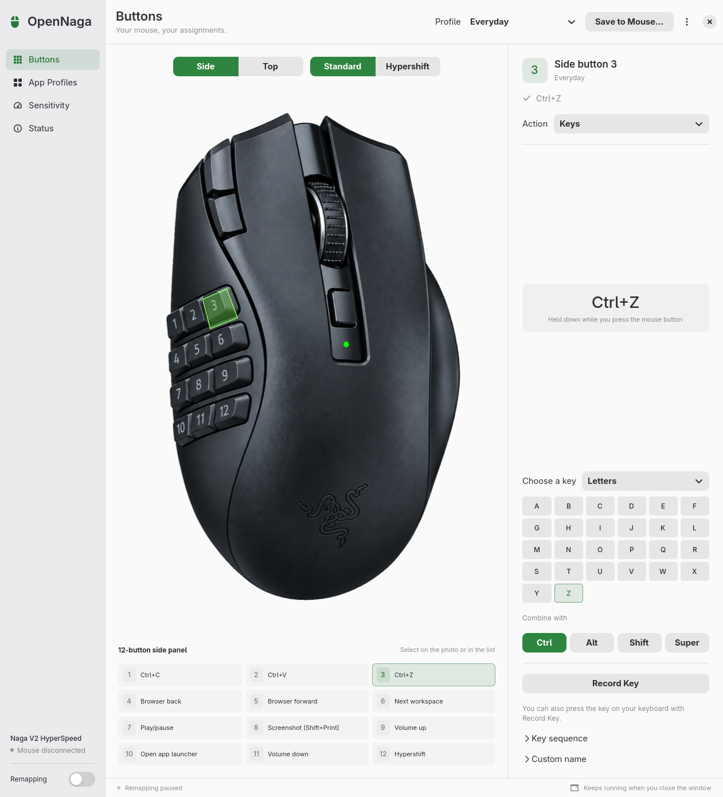

# OpenNaga for Linux

A native Linux port of [OpenNaga](../README.md) for the Razer Naga V2 HyperSpeed: the same window, the same features and the same profile format as the macOS app, written in Rust with GTK 4 and libadwaita.

OpenNaga is an independent project, not affiliated with or endorsed by Razer.

<picture>
  <source media="(prefers-color-scheme: dark)" srcset="docs/screenshot-dark.png">
  
</picture>

## Status

The Linux port is new and **not yet tested with the physical mouse**. Every part builds and its logic is covered by automated tests, and the window was checked with rendered snapshots. These parts still need real-world confirmation:

- Remapping through evdev and uinput (no input was captured or injected during development)
- DPI, polling rate, driver mode and Save to Mouse over hidraw. The protocol code is a port of the macOS implementation, which was verified on the mouse, but the Linux transport has only been read through sysfs.
- Bluetooth, sleep and wake, and unplugging the receiver

Please report what works and what does not in the [issues](https://github.com/Zer0codestuff/OpenNaga/issues), with the output of `opennaga --diagnose` where hardware is involved.

## Features

Everything the macOS app does, adapted to Linux:

- The same settings window: Buttons, App Profiles, Sensitivity and Status, with the interactive mouse photo, top view, assignment grid and inspector, in light and dark appearance
- Actions per control: keys with modifiers (recorded or picked by category), key sequences, mouse actions, system actions, text, macros, launching an app, a shell command, a profile switch, disabled or original passthrough
- A Hypershift layer held on any control, also saved to mouse memory
- Per-app profiles on Hyprland, Sway, i3 and X11 desktops
- Held keyboard modifiers combine with the mouse's keys, including keys from a profile saved in the mouse. Most desktops already share modifiers between keyboards; see [Modifiers from other keyboards](#modifiers-from-other-keyboards) for the others
- DPI (100 to 30000 per axis), polling rate (125, 500, 1000 Hz) and optional driver mode for the DPI buttons, with journaled restore at quit
- Save to Mouse and Restore Previous Assignments, with a backup of the mouse's original assignments
- Vertical and horizontal scroll sensitivity from 0.1x to 5x
- Profile backups and recovery, Undo and Redo, import with Keep Both, export
- A tray icon (StatusNotifierItem) with profile selection, the Remapping switch and per-app switching; closing the window keeps OpenNaga running
- Start at sign-in from the Status section

Saving to the mouse works exactly as on the Mac: only an explicit Save to Mouse or Restore writes the mouse memory, never an edit, a profile change, startup or quit.

## Requirements

- A Linux desktop with GTK 4.14 and libadwaita 1.5 or newer (Ubuntu 24.04, Fedora 40, Debian 13, Arch and newer)
- systemd-logind with udev (for the `uaccess` device rule)
- The HyperSpeed USB receiver (`1532:00b4`) for DPI, polling rate, driver mode and Save to Mouse. Remapping also works with the Bluetooth identity `068e:00b5`.
- To build: Rust (stable), plus the GTK 4 and libadwaita development packages

| Distribution | Build dependencies |
| --- | --- |
| Arch | `sudo pacman -S --needed rust gtk4 libadwaita` |
| Debian, Ubuntu | `sudo apt install cargo libgtk-4-dev libadwaita-1-dev` (or Rust from rustup) |
| Fedora | `sudo dnf install cargo gtk4-devel libadwaita-devel` |

## Install

### From the release archive

Download `opennaga-2.8.0-x86_64-linux.tar.gz` from the [Linux release](https://github.com/Zer0codestuff/OpenNaga/releases/tag/linux-v2.8.0). It is built on Ubuntu 24.04 and runs on distributions with glibc 2.39, GTK 4.14 and libadwaita 1.5 or newer. Install the runtime libraries first if your desktop does not already have them (`gtk4` and `libadwaita` on Arch, `libgtk-4-1 libadwaita-1-0` on Debian and Ubuntu, `gtk4 libadwaita` on Fedora).

```bash
tar -xzf opennaga-2.8.0-x86_64-linux.tar.gz
cd opennaga-2.8.0-x86_64-linux
./install.sh --user              # installs to ~/.local, no root needed
```

The archive is not signed; check it against the `.sha256` file next to it on the release page.

### From source

```bash
git clone https://github.com/Zer0codestuff/OpenNaga.git
cd OpenNaga/linux
./install.sh --user              # installs to ~/.local, no root needed
```

For a system-wide install, build as your user and install with root:

```bash
cargo build --release --locked
sudo ./install.sh --no-build --udev   # /usr/local, plus the device access rule
```

Arch users can build the package in `packaging/arch` with `makepkg -si`. `./install.sh --uninstall` (with `--user` if used) removes the program and keeps your profiles.

## Device access

Remapping reads the mouse's input nodes and writes to `/dev/uinput`; DPI and mouse memory use the receiver's hidraw node. Normal users cannot open these, so OpenNaga ships a udev rule, `60-opennaga.rules`, that grants them to the user signed in at the seat (`TAG+="uaccess"`), for this mouse only:

- Open **Status** and choose **Install Access Rule…**. It asks for the administrator password (pkexec), writes `/etc/udev/rules.d/60-opennaga.rules` and applies it to connected devices.
- Or install it yourself: `opennaga --print-udev-rule | sudo tee /etc/udev/rules.d/60-opennaga.rules`, then `sudo udevadm control --reload-rules && sudo udevadm trigger`.

The rule also gives your session access to `/dev/uinput`, which any program running as you could use to create input devices. That is how remapping tools work on Linux. Leave the rule out if that is not acceptable on your system.

Remapping, DPI and mouse memory never need root or the `input` group.

### Modifiers from other keyboards

GNOME, KDE Plasma, X11 and most compositors share held modifiers between all keyboards, so Ctrl on your keyboard plus a side button that sends C already makes Ctrl+C. Some compositors keep modifiers per device. For those, OpenNaga reads which modifiers you hold on your other keyboards and adds them to the mouse's keys. That needs read access to those keyboards, which the rule does not grant: add yourself to the `input` group (`sudo usermod -aG input $USER`, then sign in again) only if you need this. Membership lets your programs read every keyboard. The Status section shows how many keyboards OpenNaga can read.

## How remapping works on Linux

While Remapping is on, OpenNaga takes exclusive access to the mouse's keyboard interface (the 12 side buttons send number keys) and sends mapped actions and every unmapped key through a virtual keyboard named **OpenNaga Virtual Keyboard**. The pointer interface is taken over only when a click, a wheel click or tilt is remapped, or scroll sensitivity is not 1x; motion then passes through **OpenNaga Virtual Mouse** unchanged. Otherwise the pointer never goes through OpenNaga.

- **Per-device settings:** compositor settings that target the Naga by name (for example a Hyprland `device { }` block with a custom sensitivity) apply to the virtual mouse while its pointer is taken over. Add the same settings for `opennaga-virtual-mouse`.
- **Keyboard layout:** keys are sent as physical key positions, which your compositor maps with your layout, just like a real keyboard. Text and macros are typed with the active layout, using AltGr where needed. Characters your layout cannot type are sent with `wtype` (Wayland) or `xdotool` (X11) when installed.
- **Cmd:** the macOS Command modifier is the Super key on Linux, so profiles move between both systems unchanged.

## Desktop support

| | Hyprland | Sway, i3 | GNOME | KDE Plasma | Other X11 |
| --- | --- | --- | --- | --- | --- |
| Remapping, DPI, mouse memory | Yes | Yes | Yes | Yes | Yes |
| Per-app profiles | Yes | Yes | No (Wayland) | No (Wayland) | Yes, with `xprop` |
| System actions | hyprctl | swaymsg | Default shortcuts | Default shortcuts | Media keys |
| Tray icon | With a tray bar | With a tray bar | With the AppIndicator extension | Yes | With a tray |

System actions use each desktop's own tools or its default shortcuts. The inspector shows what an action does on your desktop, and Test runs it. Actions a desktop does not offer are marked unavailable instead of sending a guess.

## Profiles and files

Profiles live in `~/.config/opennaga` (or `$XDG_CONFIG_HOME/opennaga`) in the same `profiles.json` format as the Mac, with the same backup, recovery and stale-writer protection. Exported files from either system import on the other. After importing from a Mac, check:

- **Launch application** actions that point to `/Applications/...`: choose the app again.
- **App profile bindings** use macOS bundle identifiers; Linux uses the window class or app id. Add the apps again in App Profiles.
- **Shell commands** run with `/bin/sh` and may need Linux equivalents.

## Command line

```text
opennaga                         open the settings window
opennaga --background             start in the tray (used by Start at sign-in)
opennaga --diagnose               read DPI, polling rate, battery and mode as JSON (read-only)
opennaga --inspect-onboard        also dump the 21 stored and active assignments (read-only)
opennaga --probe-input 15         print decoded mouse input for 15 seconds without capturing it
opennaga --print-udev-rule        print the device access rule
opennaga --snapshot out.png       render the window to a PNG without hardware
opennaga --help                   all options
```

Only one OpenNaga runs at a time; starting it again opens the window of the running copy. Close the app before using the hardware options, which share the receiver's lock with it.

## Development

```bash
cargo test                       # model, protocol, onboard, mapper and input-frame tests
cargo clippy --all-targets
cargo build --release            # fat LTO, one codegen unit, stripped
```

The code mirrors the macOS layout: `model` holds the profile format, mapper and macro runner, `hw` the Razer protocol and onboard memory, `input` the evdev and uinput engine, `desktop` the desktop integrations and `ui` the GTK window. `input/frame.rs` holds the remapping decisions without file descriptors, so they are tested with a recorder. Protocol knowledge comes from the same public sources credited in the main README; no GPL code was copied.

## License

MIT, like the rest of OpenNaga. See [LICENSE](../LICENSE).
